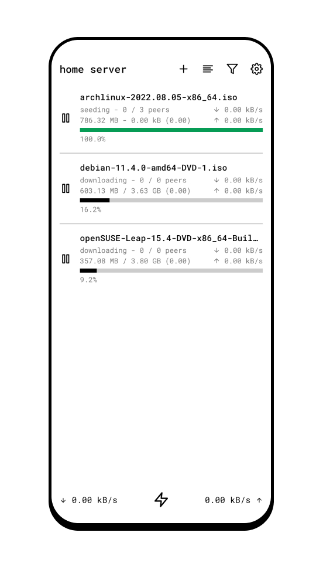
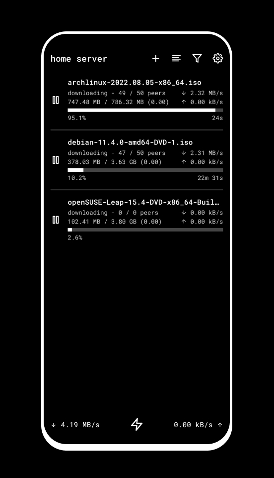
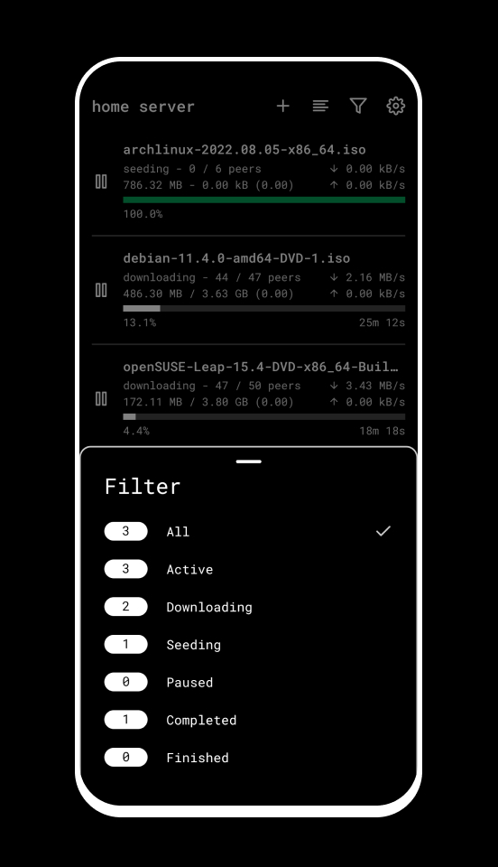
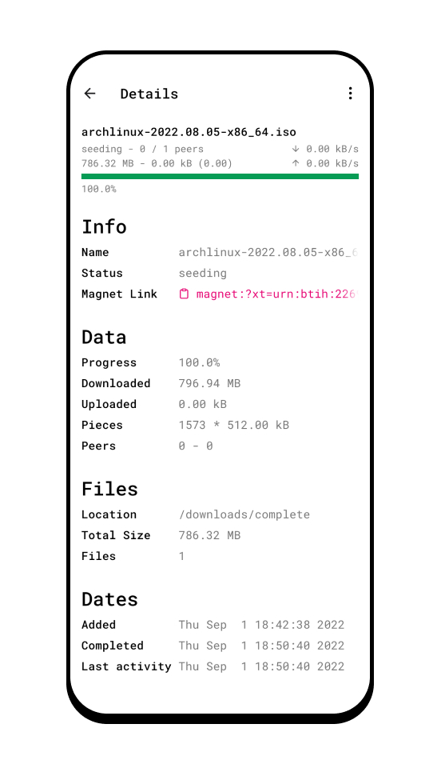
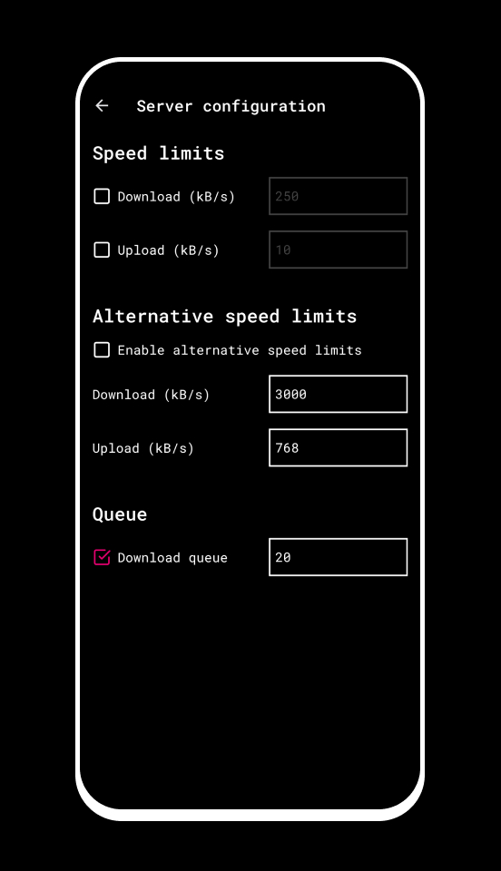

# Remote — Torrent Manager

An Android torrent manager for remote [Transmission](https://transmissionbt.com/)
and [qBittorrent](https://www.qbittorrent.org/) servers.

Remote supports multiple servers, a combined dashboard, connection failover,
Jackett and Prowlarr search, and an optional local torrent engine in beta.

## Screenshots

  
  
  
  
  

